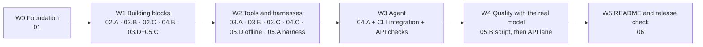

# Execution plan: waves and lanes

Specs are organized by **phase** (what to build). Execution is organized by **wave** (when to build it):
- **Track**: a unit of work from a phase spec (e.g. `02.A`), with its own files, DoD rows and commits.
- **Wave**: a sequential step. A wave starts only when every track it depends on is `done` in `STATUS.md`.
- **Lane**: a parallel slot inside a wave, run by one subagent. Lanes in the same wave never share files. A lane may run more than one track, in order.
- **API lane**: work that calls the real Gemini model. It is run only by the orchestrator, **sequentially**, to stay inside the free-tier rate limits. Subagents never call the real model.

## Track dependencies
| Track | Depends on | Calls the real model |
|---|---|---|
| 01 Setup | - | no |
| 02.A CSV loader · 02.B Manual index · 02.C Domain rules | 01 | no |
| 03.A Catalog tools · 03.B Order tool | 02.A, 02.C | no |
| 03.C Policy tool | 02.B | no |
| 03.D Support tool | 01 | no |
| 04.A Agent, prompt, app, `respond()` | 03.A-D, 04.B | manual rows 04.M1-M3 only |
| 04.B Safety plugin | 01 | no |
| 04.C CLI | 01 (on a `respond()` stub), integrated after 04.A | no |
| 05.A Agent evals: harness + cases (A1-A4) / real run (A5) | 01 / 04.A | A5 only |
| 05.B Examples | 04.A | yes |
| 05.C CI workflow | 01 | no |
| 05.D Retrieval eval: offline BM25 (D1-D3) / embeddings (D4) | 02.B | D4 only |
| 06 README | everything | no |

## Waves

### W0: Foundation (1 lane, sequential)
| Lane | Tracks | Notes |
|---|---|---|
| L1 | 01 Setup | `types.py`, `config.py`, `pyproject.toml` (all dependencies), markers, `dod_check.py`, ADRs, README skeleton. Frozen contracts for every later lane. |
- **Checkpoint:** human review (run without `--auto`): contracts, code style, commit style.

### W1: Independent building blocks (5 lanes in parallel)
| Lane | Tracks | Files owned |
|---|---|---|
| L1 | 02.A CSV loader | `data/loader.py`, `tests/test_loader.py` |
| L2 | 02.B Manual index | `data/policies.py`, `tests/test_policies_index.py` |
| L3 | 02.C Domain rules | `domain/rules.py`, `tests/test_rules.py` |
| L4 | 04.B Safety plugin | `agent/plugins/safety.py`, `tests/test_safety_plugin.py` |
| L5 | 03.D Support tool, then 05.C CI | `tools/support.py`, `tests/test_support_tool.py`, `.github/workflows/ci.yml`, `tests/test_ci_workflow.py` |
- **Integration (orchestrator):** row 02.X1 (`docs/decisions.md` assumptions), `dod_check.py` for the wave's tracks, push. CI runs from this wave on.

### W2: Tools and harnesses (6 lanes in parallel)
| Lane | Tracks | Files owned |
|---|---|---|
| L1 | 03.A Catalog tools | `tools/catalog.py`, `tests/test_catalog_tools.py` |
| L2 | 03.B Order tool | `tools/orders.py`, `tests/test_order_tools.py` |
| L3 | 03.C Policy tool | `tools/policies.py`, `tests/test_policy_tool.py` |
| L4 | 04.C CLI on a `respond()` stub | `interfaces/cli.py`, `tests/test_cli.py` |
| L5 | 05.D offline: cases, metrics, BM25 gate (D1-D3) | `evals/retrieval_cases.yaml`, `evals/retrieval_eval.py`, `evals/test_retrieval.py` |
| L6 | 05.A harness: cases, grounding checker, judge parsing, run policy (A1-A4) | `evals/cases.yaml`, `evals/judge.py`, `evals/runner.py`, `evals/test_evals.py`, `evals/test_harness.py` |
- **Integration (orchestrator):** rows 03.X1 (`tests/test_tool_contracts.py`, test-first) and 03.X2, push.

### W3: Agent (1 lane + API lane)
| Lane | Tracks | Notes |
|---|---|---|
| L1 | 04.A Agent, prompt, app, `respond()` | Replaces the stub; integrates the plugin and the CLI. |
| API | 04.M1, 04.M2, 04.M3 | Piped CLI runs and `adk web` check with the real model. Needs `.env`. |
- **Integration:** row 04.X1, push.

### W4: Quality with the real model (1 offline lane, then API lane)
| Lane | Tracks | Notes |
|---|---|---|
| L2 | 05.E containers (`Dockerfile`, `compose.yaml`, `.dockerignore`) | Added on request: reviewer runs everything with Docker. Verification (05.E3) needs a running Docker daemon. |
| L1 | 05.B script (`scripts/generate_examples.py`) | Offline; tests 05.B1-B2 run against the generated files at the end of the wave. |
| API (sequential) | 1. 05.D4 embeddings + hybrid comparison -> ADR-003 · 2. 05.A5 real eval run, fix loop (`fix(agent): ...`) until gates pass · 3. 05.B generate examples with the final agent · 4. 05.B tests | Examples come last so they show the agent that passed the evals. |
- **Integration:** push, then 05.C2 (CI green through the GitHub API).

### W5: README and release check (1 lane, sequential)
| Lane | Tracks | Notes |
|---|---|---|
| L1 | 06 README | Then 06.X3 clean-clone check, final push. |
- **Checkpoint:** human reads the README end to end before the deadline.

## Rules for every wave
- A lane gets: its track sections and DoD rows, spec 00 contracts and rules, the rule files for its paths, and its exact file list.
- TDD per track (DoD-driven); `test:` commit before `feat:` commit; commits in track order inside the wave.
- Commits are atomic and lean (`CLAUDE.md`): large tracks are split into behavior slices, each a `test:` -> `feat:` pair; generated/copied artifacts and integration fixes get their own commits.
- Shared files (`pyproject.toml`, `types.py`, `config.py`, `conftest.py`, `docs/decisions.md`, `STATUS.md`) are edited only by the orchestrator, never by a lane. A lane that needs a contract change stops and reports.
- One push per wave, after every DoD row of the wave has evidence.
